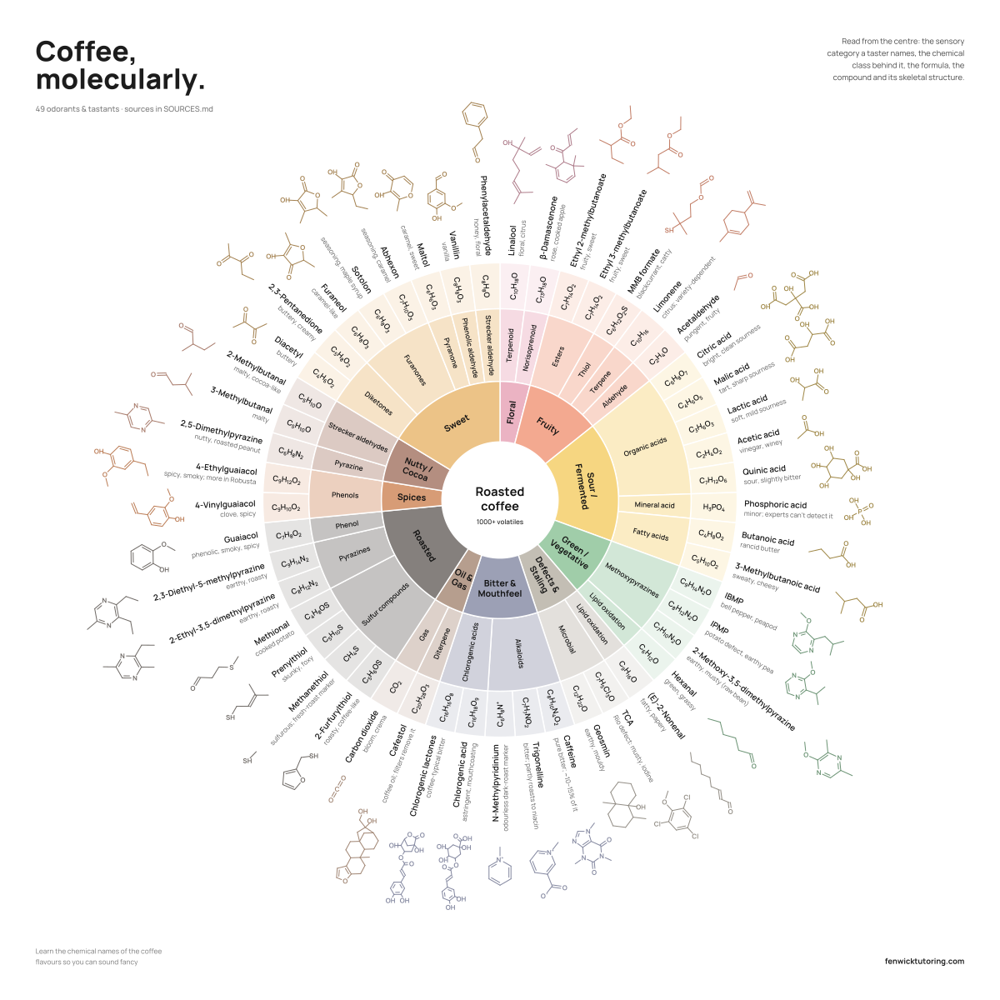

# Coffee, molecularly.

A coffee flavour wheel that traces each tasting note back to the molecules behind it: 49 odorants and tastants, from the green bean to the cup. Every compound is referenced in [SOURCES.md](SOURCES.md).



Read it from the centre outwards:

1. **Sensory category**: the note a taster names (Fruity, Roasted, Sweet…)
2. **Chemical class**: esters, pyrazines, furanones, thiols…
3. **Molecular formula**
4. **Compound** and its characteristic odour or taste
5. **Skeletal structure**

## Files

| File | Use it for |
|---|---|
| [`index.html`](index.html) | Open in any browser. Every label is plain, editable text. Print to any paper size or *Save as PDF*. |
| [`coffee-flavour-wheel.svg`](coffee-flavour-wheel.svg) | Print shops, Inkscape, Illustrator, Affinity. Text is converted to outlines, so no fonts are needed. |
| [`coffee-flavour-wheel.pdf`](coffee-flavour-wheel.pdf) | Ready-to-print vector PDF, 50 × 50 cm. Scales to any size without losing sharpness. |
| [`SOURCES.md`](SOURCES.md) | References for every compound and descriptor. |
| [`generator/`](generator) | Python scripts to rebuild the wheel with different molecules, descriptors or colours. |

## Printing your own

Everything is vector artwork, so it stays sharp at any size: an A4 handout, a 30 × 30 cm print, or a 1 m wall poster.

- **From the browser:** open `index.html` → Print → pick your paper size → set margins to *None* → tick *Background graphics*. Or choose *Save as PDF*.
- **At a print shop:** send `coffee-flavour-wheel.pdf` or `.svg` and ask for a square print at whatever size you like.

The poster is square. On non-square paper it is centred with a white border.

## Changing it

**Small edits (wording, colours of the corner text):** open `index.html` in a text editor, search for the word, and change it. Or edit the SVG in Inkscape.

**Bigger changes (add or remove molecules, recolour the wheel):** use the generator.

```bash
cd generator
pip install -r requirements.txt
python make_poster.py            # default Nordic palette
python make_poster.py riso       # or: ink, crema, signal, lab, fenwick, swiss, origin, electric, blueprint, tonal
```

- Molecules, descriptors and categories live in the `D` list at the top of `generator/wheel.py`. Each entry is `(name, formula, descriptor, SMILES)`. The structure is drawn automatically from the SMILES string, and `python wheel.py` checks each formula against its structure.
- Colour presets are in `generator/palettes.py`.
- Corner text and layout are in `POSTER` in `generator/make_poster.py`.

Running the script rewrites `index.html`, the SVG, the PDF and `preview.png`.

## Notes on the science

Simplified for enjoyment. Roasted coffee contains more than 1,000 volatile compounds; those shown are documented coffee odorants or tastants, and how strongly each is perceived depends on its concentration relative to its odour threshold. Stereochemistry is omitted.

**Sources:** every compound has a reference for its occurrence in coffee and for its descriptor in [SOURCES.md](SOURCES.md), which also lists what was changed after reader review. Formulas are computed from the drawn structures. Spotted something you would change? Open an issue or a pull request.

## Licence

- **Poster artwork and data:** [CC BY 4.0](https://creativecommons.org/licenses/by/4.0/). Share, adapt and print it, including commercially, as long as you credit *James Fenwick, fenwicktutoring.com*.
- **Code in `generator/`:** MIT. See [LICENSE](LICENSE).
- **Manrope font:** SIL Open Font License, see `generator/fonts/OFL.txt`.
